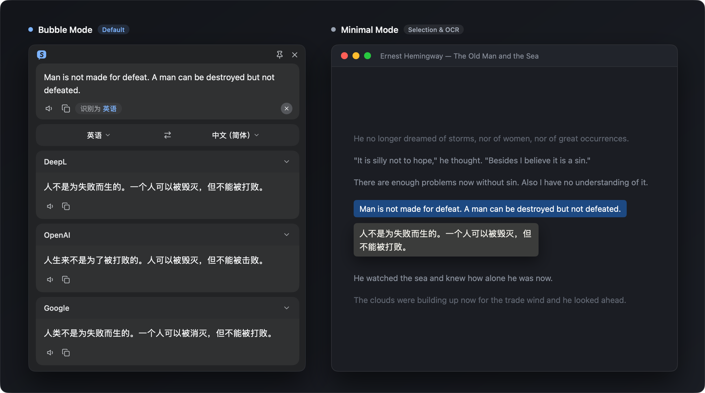

<p align="center">
  
</p>

<h1 align="center">Sotto</h1>

<p align="center">
  <strong>A lightweight, unobtrusive desktop translator for Windows and macOS users and developers</strong>
</p>

<p align="center">
  <strong>English</strong> · <a href="README_CN.md">简体中文</a>
</p>

<p align="center">
  
  
  
  
  
</p>

---

## Why Sotto?

When reading documentation, researching foreign language resources, or coding, constantly switching between browser tabs or heavy translation apps interrupts your flow. It often leads to clipboard pollution, privacy concerns, and frustration with single-engine inaccuracy.

**Sotto** (meaning *in an undertone* or *whisper*) is designed to be an always-available, silent translation companion right on your desktop. Whether triggered by **non-intrusive text selection**, **offline screen snip OCR**, or a **global shortcut**, Sotto pops up an elegant floating bubble beside your active window, queries multiple translation engines in parallel, and streams results in real time. It hides automatically on blur, keeping you entirely focused on your work.

---

## Features

- **Flexible Modes**: Enable **Minimal Translation Mode** in Settings to keep selection and snip results text-only, while the panel shortcut remains ready to summon the full Bubble view.
- **Concurrent Multi-Engine Comparison**: Query multiple translation sources at once with progressive streaming results; fold, copy, or retry cards independently.
- **Non-Intrusive Selection & Clipboard Protection**: Windows reads text via UIA and macOS via Accessibility without stealing focus; simulated copy automatically and fully restores the clipboard with history exclusion markers attached.
- **Offline Screen OCR**: Snip any screen region for instant local recognition and translation; Windows embeds PP-OCR and WinRT OCR, macOS uses native Vision, and images are never uploaded to the cloud.
- **Identifier Naming Styles**: One-click copy for English translations into `camelCase`, `PascalCase`, `snake_case`, `CONSTANT_CASE`, or `kebab-case`.
- **Credential Protection & Zero Telemetry**: Zero tracking, with API keys protected by the system credential manager or keychain.
- **Lightweight & Native**: Pure Go backend (`CGO_ENABLED=0`) with native `mygo/ui` windows; frameless design that respects system themes, hides on blur, or pins in place.

> **Bubble vs Minimal**: Sotto offers two complementary ways to view translations, balancing multi-engine comparison with distraction-free reading.

<p align="center">
  
</p>

---

## Shortcuts & Operations

Sotto provides three instant entry points with fully customizable global shortcuts:

| Action | Windows Default | macOS Default | Description |
| :--- | :--- | :--- | :--- |
| **Open Translation Panel** | `Ctrl + Alt + A` | `⌥ Option + A` | Opens the typed translation panel; if already open, focuses it and preserves existing text |
| **Screen Snip Translation (OCR)** | `Ctrl + Alt + S` | `⌥ Option + S` | Snips any screen area to extract text locally and query translation engines |
| **Selection Translation** | `Ctrl + Alt + D` | `⌥ Option + D` | Reads highlighted text in the frontmost app and shows a popup bubble beside it |

### Interactive Controls
- **Bubble Mode**: Press `Enter` to translate, `Shift + Enter` for a newline, and `Esc` to close; click the pin icon to stay open on blur; play native TTS for source and translated text, and fold or retry individual cards.
- **Minimal Translation Mode**: Shows selection and snip translations in independent floating overlays beside the target region; drag anywhere to reposition, scroll smoothly through long text, and press `Esc` or right-click to close—while the input panel shortcut still opens the full bubble anytime.

---

## Supported Translation Services

Open **Settings** from the tray menu to toggle services, reorder cards via drag-and-drop, configure API keys, and customize model names:

| Service | Type | Details & Capabilities |
| :--- | :--- | :--- |
| **Bilibili (Index)** | Keyless | Experimental endpoint, enabled by default |
| **Online Dictionary** | Keyless | Phonetics, parts of speech, and English definitions for single words |
| **Google Translate** | Keyless | Disabled by default; toggle on in Settings |
| **DeepL** | API Key | Industry-leading translation quality; supports both DeepL Free and DeepL Pro keys |
| **OpenAI-Compatible** | API Key | Fully custom Base URL and model names (works seamlessly with DeepSeek, Moonshot, Qwen, etc.) |
| **SiliconFlow** | API Key | Aggregated open-source LLMs; defaults to `tencent/Hunyuan-MT-7B` |
| **Zhipu AI** | API Key | GLM family models; defaults to `glm-4.7-flash` |
| **Volcengine (ByteDance)** | API Key | High-performance machine translation by ByteDance |
| **Baidu Translate** | API Key | General text translation API |
| **Tencent Cloud (TMT)** | API Key | Tencent Cloud machine translation service |
| **Youdao** | API Key | NetEase Youdao translation API |
| **Microsoft Azure** | API Key | Azure Cognitive Services Translator |

> [!NOTE]
> Sotto sends text for translation and dictionary lookup to the respective third-party providers. Certain keyless integrations use experimental endpoints. Service availability, free quotas, and pricing follow each provider's latest terms.

---

## Download & Installation

Visit the [GitHub Releases page](https://github.com/doyuli/sotto/releases/latest) to download the package corresponding to your operating system and CPU architecture:

| Operating System | Architecture | Package Format | Notes |
| :--- | :--- | :--- | :--- |
| **Windows 10 / 11** | 64-bit Intel / AMD (x86_64) | `sotto-setup-<version>-amd64.exe` | Standard installer for x64 Windows PCs |
| **Windows 10 / 11** | 64-bit ARM (arm64) | `sotto-setup-<version>-arm64.exe` | For Surface Pro, Qualcomm Snapdragon X devices |
| **macOS 14+** | Apple Silicon (M-series / arm64) | `sotto-<version>-arm64.dmg` | Menu-bar accessory without Dock icon; native Vision OCR |

### macOS First-Launch Guide
1. **Gatekeeper Approval**: The macOS build uses ad-hoc signing. When opening Sotto for the first time after moving it to `Applications`, if prompted by Gatekeeper, navigate to **System Settings → Privacy & Security** and click **"Open Anyway"** ([Apple official guide](https://support.apple.com/en-us/102445)).
2. **Permissions**: Selection translation requires **Accessibility** permission; screen snip translation requires **Screen Recording** permission.

---

## Development & Building

### Prerequisites
- [Go](https://go.dev/) >= 1.27.3
- [Bun](https://bun.sh/) (for the MyGo CLI toolchain)

### Commands

```bash
# 1. Install toolchain dependencies
bun install

# 2. Run the desktop app in development mode with hot reload
bun run dev

# 3. Run unit tests
CGO_ENABLED=0 go test ./...

# 4. Check native UI usage compliance
bunx mygo vet .

# 5. Build production packages for the supported targets
bun run build:win      # Windows x64 and arm64 executables, OCR assets, and NSIS installers
bun run build:mac      # Apple silicon .app bundle and DMG (run on macOS)
```

The Windows build scripts exclude WebView2 with `mygo_nowebview`. Use `bun run build:win:x64` or `bun run build:win:arm64` for one architecture. Add `-skip-installer` to build just the executable and its runtime assets. For local macOS verification, `bun run build:mac -skip-dmg -skip-notarize` builds and signs the `.app` bundle.

> For automated test suites, platform probes, and desktop acceptance testing, refer to [e2e/README.md](e2e/README.md).

---

## Acknowledgments

- [Easydict](https://github.com/tisfeng/Easydict): For inspiring Sotto's multi-engine comparison design and user experience.
- [Mygo](https://mygo.egoist.dev/): The lightweight, modern Go desktop UI framework powering Sotto.
- Thanks to the [LINUX DO](https://linux.do/) community for supporting Sotto.
