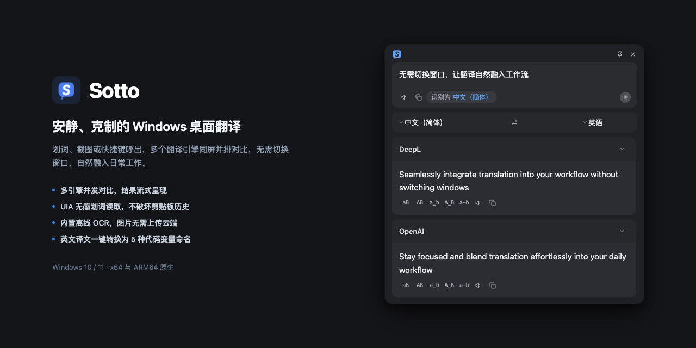

<p align="center">
  
</p>

<h1 align="center">Sotto</h1>

<p align="center">
  <strong>A lightweight, unobtrusive desktop translator built for Windows users and developers</strong>
</p>

<p align="center">
  <strong>English</strong> · <a href="README_CN.md">简体中文</a>
</p>

<p align="center">
  
  
  
  
  
</p>

<p align="center">
  
</p>

Sotto is a desktop translation utility tailored for Windows. Whether you are reading documentation, writing code, or processing multi-language content, Sotto delivers translation results right beside your active window via selection capture, screen snips, or quick keyboard invocation.

Combining multi-engine streaming comparison, offline screen OCR, non-intrusive selection without clipboard pollution, and instant code identifier formatting, Sotto keeps you focused on your work without window-switching fatigue.

[Download for Windows](https://github.com/doyuli/sotto/releases/latest) · Choose `amd64` for 64-bit PCs (Intel / AMD) or `arm64` for Windows on ARM devices (e.g. Surface Pro, Snapdragon X).

---

## Features

- ⚡ **Concurrent Multi-Engine Comparison**: Query multiple translation sources at once with progressive streaming results; fold or retry cards independently.
- 🖱️ **Non-Intrusive Selection**: Reads text via UI Automation (UIA) without copying; fallback simulated copy automatically restores your clipboard without polluting history.
- 📷 **Offline Dual-Engine OCR**: Snip any screen region to translate locally. Powered by on-device PP-OCR and native WinRT OCR—no images uploaded to the cloud.
- 💻 **Identifier Naming Styles**: One-click copy for English translations into `camelCase`, `PascalCase`, `snake_case`, `CONSTANT_CASE`, or `kebab-case`.
- 🔒 **Secure Credentials & Zero Telemetry**: Strictly local with no tracking. API keys are safely encrypted in Windows Credential Manager (DPAPI) rather than plain-text configs.
- 🎨 **Lightweight & Native**: Pure Go backend (`CGO_ENABLED=0`) with WebView2 for minimal memory usage; frameless design that respects themes, hides on blur, or pins in place.

---

## Supported Translation Services

| Service | Type | Notes |
| --- | --- | --- |
| **Google Translate** | Keyless | Optional keyless endpoint; disabled by default |
| **Bilibili (Index)** | Keyless | Experimental keyless endpoint |
| **Dictionary** | Keyless | Displays phonetics and definitions for English words |
| **DeepL** | API Key | Supports both Free and Pro keys |
| **OpenAI-Compatible** | API Key | Custom Base URL and model names (DeepSeek, Moonshot, Qwen, etc.) |
| **SiliconFlow** | API Key | Custom model; defaults to `tencent/Hunyuan-MT-7B`; identity verification required |
| **Zhipu** | API Key | Custom model; defaults to `glm-4.7-flash` |
| **Volcengine (ByteDance)** | API Key | High-performance machine translation |
| **Baidu Translate** | API Key | General text translation API |
| **Tencent Cloud (TMT)** | API Key | Machine translation service |
| **Youdao** | API Key | NetEase Youdao translation API |
| **Microsoft Azure** | API Key | Azure Cognitive Services Translator |

> Translation and dictionary lookups use third-party services and send the relevant text to those providers. Some keyless integrations use unofficial or experimental endpoints. Availability, free quotas, and pricing follow each provider’s current policies. Translations are for reference only.

> Open **Settings** from the tray menu to toggle services, reorder cards, manage keys, and configure models. Leave a model blank to restore its default.

---

## Shortcuts & Quick Guide

| Action | Default Shortcut | Description |
| --- | --- | --- |
| **Open Translation Panel** | `Ctrl+Alt+A` | Invokes the centered translation panel (starts a fresh session) |
| **Screen Region Translation (OCR)** | `Ctrl+Alt+S` | Snips any screen area to extract text locally and translate |
| **Selection Translation** | `Ctrl+Alt+D` | Reads highlighted text in the active app and opens a popup bubble |

- **In the panel**: Press `Enter` to translate, `Shift+Enter` for a new line, `Esc` to close.
- **Controls**: Pin (📌) to keep the bubble floating, listen to pronunciation (🔊), fold cards, or retry failed services.

---

## System Requirements & Download

- **Operating System**: Windows 10 / Windows 11
- **Runtime**: Microsoft Edge WebView2 Runtime (pre-installed on modern Windows)
- **Architectures**:
  - 64-bit x86 PC (Intel / AMD): download `sotto-*-windows-amd64-installer.exe`
  - 64-bit ARM device (e.g. Surface Pro / Snapdragon X): download `sotto-*-windows-arm64-installer.exe`

👉 [Download the latest release on GitHub Releases](https://github.com/doyuli/sotto/releases/latest)

---

## Development

Requires Go (>= 1.27.3), Bun, and WebView2 Runtime. The MyGo module, `mygo-cli`, and `mygo-runtime` are pinned to 0.8.3.

```bash
bun install                  # Install dependencies
bun run dev                  # Start dev server (with hot reload)
bun run typecheck            # Run type checking
CGO_ENABLED=0 go test ./...  # Run unit tests
bun run build                # Build for current architecture
bun run build:win            # Build for both x64 and arm64
```

> Run `bunx mygo generate` after modifying Go backend bindings to update TypeScript types.

---

## Acknowledgments

Thanks to the authors and contributors of [Easydict](https://github.com/tisfeng/Easydict) for inspiring Sotto.

Thanks to [Mygo](https://mygo.egoist.dev/) for the framework that powers Sotto.
