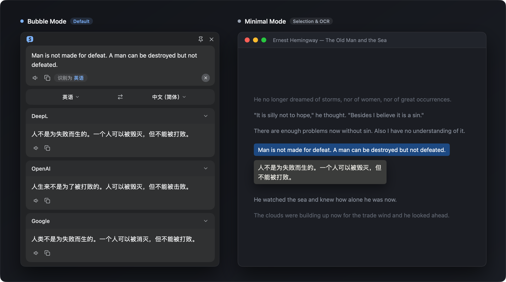

<p align="center">
  
</p>

<h1 align="center">Sotto</h1>

<p align="center">
  <strong>划词、截图、多引擎同屏对比——为 Windows 与 macOS 打造的轻量桌面翻译助手</strong>
</p>

<p align="center">
  <a href="README.md">English</a> · <strong>简体中文</strong>
</p>

<p align="center">
  
  
  
  
</p>

<p align="center">
  无感划词 · 本地离线 OCR · 多引擎流式对比 · 简约无打扰浮窗 · 开发者命名转换
</p>

<p align="center">
  
</p>

## 核心亮点

### 1. 双重形态：深度对照，或安静阅读
- 完整气泡模式：同时并发请求多个翻译源，流式实时输出；支持折叠/重试单个结果、图钉固定对比、以及系统原生语音朗读。
- 简约翻译模式：划词或截图直接在目标旁浮现纯译文浮窗，支持多个结果独立并存、自由拖拽与平滑滚动，阅读外文文档或对照数据时零干扰；输入快捷键随时仍可呼出完整气泡。

### 2. 为代码与高频读写打磨的细节
- 一键生成变量名：英文释义可直接复制为 `camelCase`、`PascalCase`、`snake_case`、`CONSTANT_CASE`、`kebab-case` 五种编程命名格式。
- 智能文本预处理：在「设置」中按需开启自动拆分驼峰/下划线标识符、剥离代码注释与 Markdown 符号、自动合并 PDF/文档断行，告别手动整理文本。
- 可检索的本地历史：按原文或译文秒搜历史记录，支持键盘上下选择回车即复制、发音与一键换源重译。

### 3. 原生轻量，隐私从不妥协
- 无 WebView 的纯 Go 原生界面：全栈 `CGO_ENABLED=0` 构建（Windows 排除 WebView2，macOS 无 Dock 图标菜单栏常驻），反应迅捷；译文浮窗默认不抢占当前窗口焦点，失焦即收。
- 无感划词，守护剪贴板：优先通过系统无障碍接口（Windows UIA / macOS AX）直接读取选中文本，尽最大可能保持原剪贴板内容完整。
- 完全离线的截图 OCR 与词典：Windows 内置 PP-OCR（及 WinRT 兜底），macOS 原生调用 Apple Vision，截图全程本地识别；内置离线英汉词典，单英文词秒查音标与释义。
- 零遥测与系统级密钥托管：无任何埋点上报，所有 API 密钥均加密存储在 Windows 凭据管理器或 macOS 钥匙串中。

## 翻译引擎与能力

可在「设置」中一键开关任意引擎、拖拽排序卡片，或配置自定义大模型接口：

| 分类 | 支持服务 | 亮点说明 |
| :--- | :--- | :--- |
| 免密钥 · 即装即用 | 离线词典、有道查词与翻译、Bilibili (Index)、Google 翻译、Magpie | 离线词典免网秒查音标释义；Magpie 可自动发现本地网关模型与路由 |
| AI 大模型 | OpenAI 兼容接口、硅基流动 (SiliconFlow)、智谱 AI (Zhipu) | 支持流式输出与自定义 Base URL / 模型名，轻松接入 DeepSeek、Qwen、GLM 等 |
| 专业机翻 API | DeepL (Free / Pro)、火山引擎、百度翻译、腾讯云 TMT、网易有道、微软 Azure | 按需填写自有密钥，稳定高速对照 |

> [!NOTE]
> 离线词典与截图 OCR 均在本地完成；在线翻译文本仅发送至你主动启用的对应服务商。

## 快捷键与上手

所有全局快捷键均可在「设置 → 快捷键」自由修改：

| 功能 | Windows 默认 | macOS 默认 | 作用 |
| :--- | :--- | :--- | :--- |
| 打开翻译面板 | `Ctrl + Alt + A` | `⌥ Option + A` | 呼出 / 关闭输入气泡，`Enter` 翻译、`Shift + Enter` 换行 |
| 屏幕截图翻译 | `Ctrl + Alt + S` | `⌥ Option + S` | 框选屏幕任意区域，本地 OCR 识别并即时翻译 |
| 选中文本翻译 | `Ctrl + Alt + D` | `⌥ Option + D` | 直接读取当前选中的文本，在光标旁弹出结果 |
| 切换简约模式 | `Ctrl + Alt + F` | `⌥ Option + F` | 在“完整气泡”与“纯译文浮窗”间切换后续划词/截图的呈现形态 |
| 打开翻译历史 | `Ctrl + Alt + H` | `⌥ Option + H` | 打开 / 关闭「翻译历史」，支持检索、回溯与换源重译 |

- 气泡窗口：失焦自动收起，点击右上角图钉可钉住常驻；按 `Esc` 关闭。
- 简约浮窗：按住任意位置拖拽，长文内部滚动，按 `Esc` 或鼠标右键关闭。

## 下载与安装

前往 [GitHub Releases](https://github.com/doyuli/sotto/releases/latest) 下载对应安装包：

| 系统 | 架构 | 安装包 |
| :--- | :--- | :--- |
| Windows 10 / 11 | x64 (`x86_64`) | `sotto-setup-<version>-amd64.exe` |
| Windows 10 / 11 | ARM64 (`arm64`) | `sotto-setup-<version>-arm64.exe` |
| macOS 14+ | Apple Silicon (`arm64`) | `sotto-<version>-arm64.dmg` |

<details>
<summary>macOS 首次启动指引（权限与安全性放行）</summary>

1. 安全性放行：当前 macOS 安装包采用 ad-hoc 签名。拖入 `Applications` 首次打开若被拦截，请前往「系统设置 → 隐私与安全性」点击“仍要打开”（详见 [Apple 官方说明](https://support.apple.com/zh-cn/102445)）。
2. 系统权限：划词翻译需要「辅助功能 (Accessibility)」权限；截图 OCR 需要「屏幕录制 (Screen Recording)」权限。

</details>

## 本地开发与构建

需要 [Go](https://go.dev/) >= 1.27.3 与 [Bun](https://bun.sh/)：

```bash
bun install                 # 安装 MyGo CLI 工具链
bun run dev                 # 启动热重载桌面开发环境
CGO_ENABLED=0 go test ./... # 运行单元测试与 UI 回归用例
bunx mygo vet .             # 检查 MyGo 原生组件与生命周期规范
```

<details>
<summary>发布构建与端到端测试</summary>

```bash
bun run build:win   # 构建 Windows x64 / arm64 可执行文件、OCR 资源与 NSIS 安装包
bun run build:mac   # 构建 Apple Silicon .app 与 DMG（需在 macOS 下运行）
```

- 单独构建 Windows 单架构可使用 `bun run build:win:x64` 或 `bun run build:win:arm64`（附加 `-skip-installer` 可跳过安装包生成）；macOS 本地验证可用 `bun run build:mac -skip-dmg -skip-notarize`。
- 平台原生探针与桌面端到端验收请参阅 [e2e/README.md](e2e/README.md)。

</details>

---

## 致谢

- [Easydict](https://github.com/tisfeng/Easydict)：为 Sotto 的设计交互与多服务对比体验提供了灵感与范式。
- [Mygo](https://mygo.egoist.dev/)：提供了轻量优雅的 Go 桌面 UI 应用框架支持。
- [LINUX DO](https://linux.do/)：社区为 Sotto 提供了支持。

---

## 开源许可

GPL-3.0-only。详见 [LICENSE](LICENSE)。
