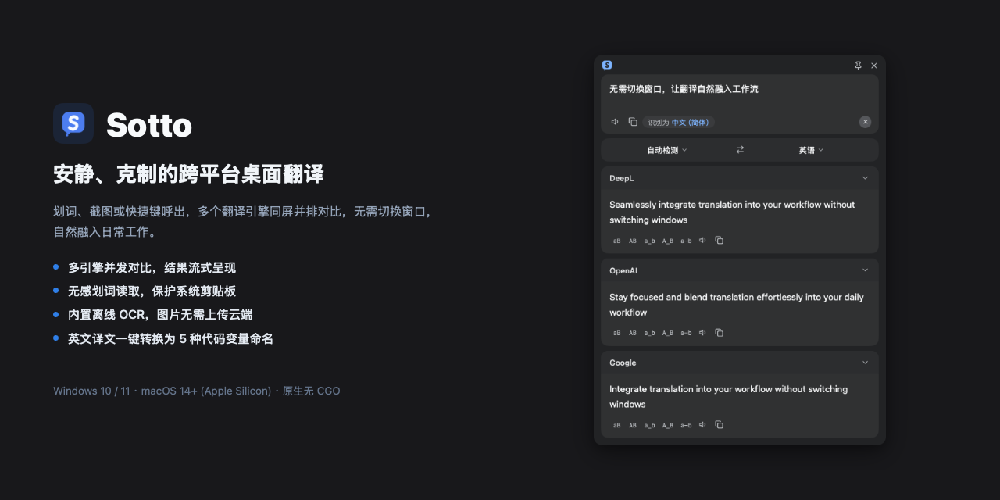

<p align="center">
  
</p>

<h1 align="center">Sotto</h1>

<p align="center">
  <strong>专为 Windows 与 macOS 用户及开发者打造的轻量、无感、高效桌面翻译工具</strong>
</p>

<p align="center">
  <a href="README.md">English</a> · <strong>简体中文</strong>
</p>

<p align="center">
  
  
  
  
  
</p>

<p align="center">
  
</p>

---

## 为什么选择 Sotto？

在查阅多语言文档、浏览外文资料或编写代码时，频繁切换翻译网页或庞大的翻译软件不仅打断思路，还伴随着剪贴板污染、隐私泄漏和单一引擎翻译不准确的困扰。

**Sotto**（意为轻声、私语）致力于成为桌面端始终就绪、不惹人注目的翻译助手。通过**无感划词**、**离线截图 OCR** 或**快捷键输入**，Sotto 会在当前工作窗口旁弹出轻量气泡，同时并发请求多个翻译源并流式呈现，译完即用，失焦即收，让你始终专注于当前任务。

---

## 核心特性

- **多引擎流式对比**：一次触发，多个翻译源并发查询，流式呈现，支持独立折叠、复制与重试。
- **无感划词与剪贴板保护**：Windows 基于 UIA、macOS 基于 Accessibility 读取文本，不抢焦点。回退到模拟复制时，会在确认安全后还原可读取的剪贴板内容。Windows 的历史排除标记仅适用于 Sotto 自身的恢复写入。
- **离线截图 OCR**：框选屏幕后在本机识别文字，再发送文字进行翻译。Windows 内置 PP-OCR，可回退至 WinRT OCR，macOS 使用原生 Vision。图片留在本机。
- **变量命名转换**：一键将英文释义转换为 `camelCase`、`PascalCase`、`snake_case`、`CONSTANT_CASE`、`kebab-case` 代码命名格式。
- **凭据保护与零遥测**：零埋点。API 密钥由系统凭据管理器或钥匙串保护。
- **轻量原生体验**：纯 Go 后端（`CGO_ENABLED=0`）搭配原生窗口；无边框设计跟随系统深浅色主题，失焦自动收起，亦可钉住常驻。

---

## 快捷键与操作

Sotto 提供三种呼出途径，均支持自定义快捷键：

| 功能 | Windows 默认 | macOS 默认 | 说明 |
| :--- | :--- | :--- | :--- |
| **打开翻译面板** | `Ctrl + Alt + A` | `⌥ Option + A` | 呼出输入翻译面板；已打开时聚焦并保留原有文本 |
| **屏幕截图翻译 (OCR)** | `Ctrl + Alt + S` | `⌥ Option + S` | 框选屏幕任意区域，完全本地识别文字并即时发起翻译 |
| **选中文本翻译 (划词)** | `Ctrl + Alt + D` | `⌥ Option + D` | 自动读取当前前台应用中选中的文本并在光标旁弹出气泡 |

### 气泡面板交互
- **键盘操作**：输入框内按 `Enter` 立即翻译，按 `Shift + Enter` 插入换行，按 `Esc` 快速关闭气泡。
- **浮窗控制**：点击钉住图标可固定气泡防止失焦关闭；支持原词与译文的本地文本朗读。
- **卡片管理**：每张结果卡片均可独立折叠收起，单引擎请求失败时支持一键重试。

---

## 支持的翻译服务

可在系统托盘进入「设置」页面，自由勾选启用引擎、拖拽调整卡片展示顺序，或配置各服务 API 密钥与自定义模型：

| 引擎 / 服务 | 类型 | 说明与特性 |
| :--- | :--- | :--- |
| **Bilibili (Index)** | 免密钥 | 实验性接口，默认开启 |
| **在线词典** | 免密钥 | 查询单个英文单词的音标、词性和英文释义 |
| **Google 翻译** | 免密钥 | 默认关闭，可在设置中启用 |
| **DeepL** | API 密钥 | 业界领先的翻译质量，支持 DeepL Free 与 Pro Key |
| **OpenAI 兼容接口** | API 密钥 | 支持自定义 Base URL 与模型名（轻松接入 DeepSeek、Moonshot、通义千问等） |
| **硅基流动 (SiliconFlow)** | API 密钥 | 聚合多款优秀开源大模型，默认搭载 `tencent/Hunyuan-MT-7B` |
| **智谱 AI (Zhipu)** | API 密钥 | 支持智谱开放平台模型，默认搭载 `glm-4.7-flash` |
| **火山引擎 (ByteDance)** | API 密钥 | 字节跳动机器翻译大模型与高效文本翻译 |
| **百度翻译** | API 密钥 | 百度翻译开放平台通用文本翻译接口 |
| **腾讯云 (TMT)** | API 密钥 | 腾讯机器翻译服务 |
| **网易有道** | API 密钥 | 有道智云专业翻译接口 |
| **微软 Azure** | API 密钥 | Azure 认知服务文本翻译 |

> [!NOTE]
> 用于翻译和查词的文本会发送给对应的第三方服务。部分免密钥接口属于实验性网络端点。服务可用性、免费额度和计费以各服务商的最新政策为准。

---

## 下载与安装

请前往 [GitHub Releases 页面](https://github.com/doyuli/sotto/releases/latest) 下载对应系统与硬件架构的安装包：

| 操作系统 | 适用硬件与架构 | 安装包文件 | 说明 |
| :--- | :--- | :--- | :--- |
| **Windows 10 / 11** | 64 位 Intel / AMD (x86_64) | `sotto-setup-<version>-amd64.exe` | 适用于普通 Windows PC |
| **Windows 10 / 11** | 64 位 ARM (arm64) | `sotto-setup-<version>-arm64.exe` | 适用于 Surface Pro、高通 Snapdragon X 等设备 |
| **macOS 14+** | Apple Silicon (M 系列芯片 / arm64) | `sotto-<version>-arm64.dmg` | 常驻菜单栏无 Dock 图标，原生 Vision 识别 |

### macOS 首次使用提示
1. **安全性放行**：目前 macOS 软件包采用 ad-hoc 签名。将应用拖入 `Applications` 首次打开时，若系统拦截提示，请在 **系统设置 → 隐私与安全性** 中点击 **“仍要打开”**（详情参考 [Apple 官方支持说明](https://support.apple.com/zh-cn/102445)）。
2. **系统权限**：划词翻译需授予 **辅助功能 (Accessibility)** 权限，截图识别需授予 **屏幕录制 (Screen Recording)** 权限。

---

## 本地开发与构建

### 环境准备
- [Go](https://go.dev/) >= 1.27.3
- [Bun](https://bun.sh/)（用于运行 MyGo CLI 工具链）

### 开发命令

```bash
# 1. 安装项目工具链依赖
bun install

# 2. 启动原生桌面开发环境（支持热重载）
bun run dev

# 3. 运行项目单元测试
CGO_ENABLED=0 go test ./...

# 4. 检查 mygo/ui 原生组件用法合规性
bunx mygo vet .

# 5. 打包构建当前架构产物
bun run build

# 6. 跨平台打包构建
bun run build:win      # 同时构建 Windows x64 与 arm64 安装包
bun run build:mac      # 构建 macOS Apple Silicon (arm64) DMG 安装镜像
```

> 自动化测试与系统平台端到端验收指南请参阅 [e2e/README.md](e2e/README.md)。

---

## 致谢

- [Easydict](https://github.com/tisfeng/Easydict)：为 Sotto 的设计交互与多服务对比体验提供了灵感与范式。
- [Mygo](https://mygo.egoist.dev/)：提供了轻量优雅的 Go 桌面 UI 应用框架支持。
