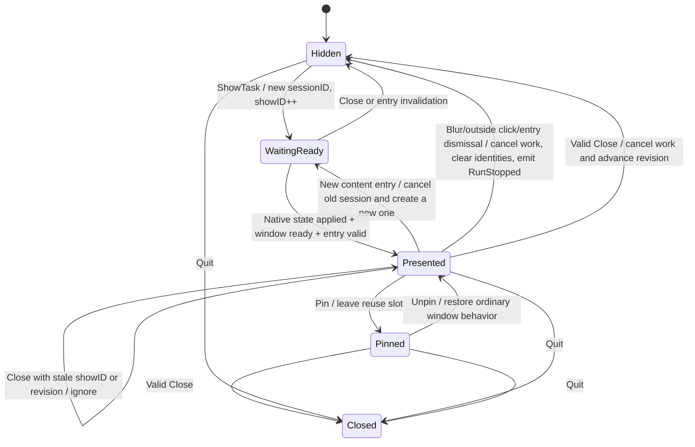
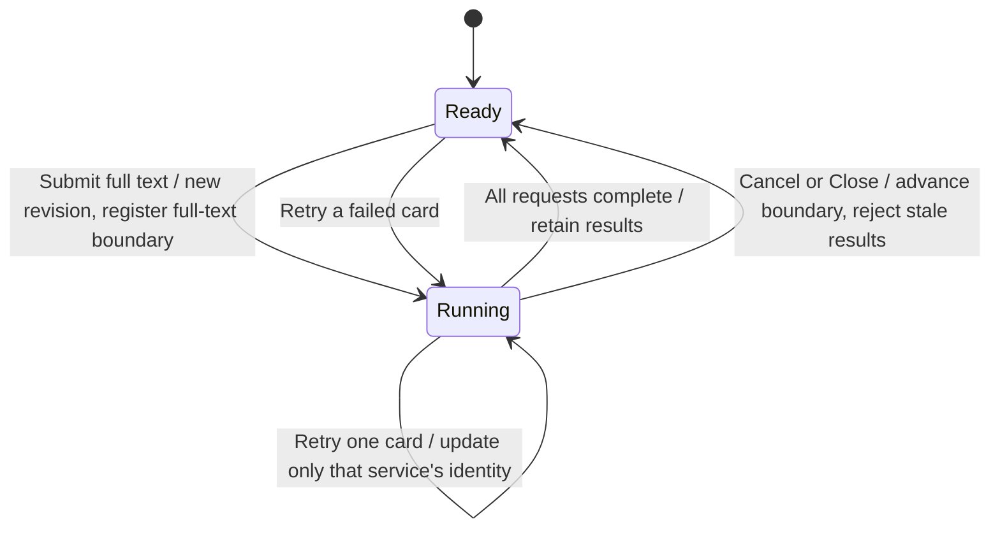

# Translation Window State and Lifecycle

This document records the current implementation's constraints so behavior is preserved when separating translationSession / presentation in the future. Pure-logic and native `ui.NewTester` tests do not constitute desktop acceptance on actual hardware. See `e2e/README.md` for Windows execution instructions and desktop acceptance procedures.

## State Ownership

| Scope | Fields | Meaning and Update Conditions |
|---|---|---|
| Global entry task | `entryTask.id / ctx` | A new input, selection, or OCR entry invalidates previous selection/recognition work. Switching entries also dismisses the unpinned bubble and cancels its work. |
| Window object | `bubble.id`, `win` | Native window identity, unchanged throughout its lifetime. Input, selection, and OCR share one reusable window; pinning removes it from reuse. |
| Content session | `sessionID` | Identity of a session for one set of source content. A new input, selection, or OCR entry replaces the session. Reopening an already-visible, unpinned input panel only focuses it and preserves the session if the current input entry is still valid. |
| Snapshot order | `generation` | Increasing content-session sequence within a window, used by the native view to reject old session snapshots. A new sessionID is an opaque string and cannot be compared chronologically. |
| Presentation | `showID` | Increments on every explicit invocation, even if sessionID and source text are unchanged. Prevents Close from a previous presentation from closing a reopened panel. |
| Presentation | `closeClaimed` | Close is accepted at most once for the same showID; reset on a new presentation. Native close also sets it. |
| Request order | `revision` | Highest request/cancel/close version accepted by the backend; incremented by the native view before sending a new command. Orders full-text requests, cancellation, and closure, and synchronizes snapshots. |
| Full-text boundary | `fullRevision` | Boundary of the latest full-text request or cancel/close. A single-card retry must be newer than this boundary, but need not be newer than another service's retry. |
| Current request | `reqID` | Request corresponding to the highest revision, used for the view's overview and latest metadata. Must not reject still-valid results from other services. Cleared on cancel/close. |
| Full-text request | `fullReqID` | Identity of the current full-text request. Late metadata may still register services that have not been retried, but must not overwrite retried services. |
| Service order | `serviceRevisions[service]` | Latest accepted retry version per service; prevents older retries from overwriting the same card out of order. Reset on a full-text request. |
| Service identity | `serviceRequests[service]` | The reqID whose results this card currently accepts. Registered atomically when a retry starts, without waiting for credential reads. |
| Running work | `runCancels[reqID]` | Cancellation function per request. A full-text request may still have other unfinished services, so a single-card retry does not cancel it. Removed on completion; all are canceled on full-text replacement/cancel/close. |
| Recognition phase | `cancelCapture`, `phase` | Cancellation function and presentation phase before OCR becomes a translation request. Recognition results may update only the original session's window while revision remains -1. |
| Deferred display | `canShow`, `ready`, `presentationShown` | First display occurs after the native view applies the current state, the window is ready, and the entry remains valid. No late popup is allowed after close or entry invalidation. |
| Workspace presentation | `workspace` | Workspace generation recorded on presentation or explicit restoration. Independent of `canShow` entry ownership; restoring a pinned bubble must not reclaim its old entry. |

The native `bubbleView.serviceReqIDs` tracks service request identities, `cards` stores results, and stable control identities preserve editing, selection, and focus state. When blur, an outside click, or a new entry dismisses an unpinned bubble, the current presentation session ends: cancel full-text requests, single-card retries, and OCR; clear result identities; set `closeClaimed`; and emit `RunStopped`. Reopening after hiding starts a new session and clears the input draft, translations, and request identities. If the current input entry remains valid and the unpinned panel is already visible, reopening only focuses it: it does not revoke the entry, reset content, or stop in-flight translation. It only increments showID to invalidate late close, blur, and outside-click callbacks from the old presentation. Pinned windows retain independent sessions.

## Presentation and Closure

### Opening and Closing Each Window

| Window | Opening and Reuse | Hiding, Closing, and Quitting |
|---|---|---|
| Input panel | If the current entry is valid and the panel is unpinned and visible, reopening only focuses it and advances showID, preserving the draft, languages, and work. Other input entries hide screenshot overlays, end the old presentation, and start a blank session in the shared window. | With auto-hide enabled, blur or an outside click ends the current presentation session: cancel work, clear request identities, emit `RunStopped`, then hide. Esc/the close button also cancels work before hiding. Reopening after hiding replaces the session. |
| Selection/OCR bubble | Shares the input panel's window; each new entry replaces the session. Selection takes over the window only after capture completes and remains valid. OCR first shows recognition state, then updates the recognition result within the same session. | Blur or an outside click with auto-hide enabled, as well as entry switches or closure, ends the current presentation session: cancel capture/translation, clear request identities, and emit `RunStopped`. Later results must not update or redisplay the hidden window. |
| Screenshot overlay | The OCR entry first hides the transient bubble, then opens native overlays for the current displays. Input or selection entries revoke old capture work and hide overlays. | Esc, right-click, blur, or native close cancels the current round. Ordinary hiding retains reusable windows; windows that have been dragged in or are still used by capture are replaced or destroyed later under the existing lease rules. |
| Pinned bubble | Leaves the shared reuse slot; subsequent entries create a window as needed. Unpinning returns it to the shared slot, canceling and destroying the displaced transient window even if that window is already hidden. | Does not automatically hide on blur. Closing actually destroys the window and stops its work. |
| Settings window | Independent singleton; reopening calls Show/Focus without acquiring translation entry ownership. | Closing destroys the native window. The app retains the settings controller and the same task queue; reopening inherits pending save state. Opening settings may trigger bubble auto-hide through blur. |
| Application quit | OnBeforeQuit sets quitting and revokes the entry; new entries are no longer dispatched. | All window OnClose handlers allow closure, preserving separate paths for tray residency and actual quitting. |

1. `ShowTask` is entered from a worker goroutine. Selecting or creating the shared window, committing presentation, and validation/native operations for `SetPinned` and `Close` run on the main thread.
2. Close must match the window, sessionID, and showID, carry a newer revision, and find closeClaimed unset. The native view reserves an incremented revision before calling, but does not clear active requests or cards early; rejection or failure does not roll back the consumed sequence number. The backend validates before canceling and closing. Do not split cancellation into a separate call unprotected by showID.
3. `OnClose` advances revision, cancels work, and emits RunStopped with showID. An accepted Close ends the current presentation; the next command for that presentation, issued while closure is pending, may be rejected by this boundary. The view settles its state using the matching RunStopped. If reopening advances showID on the UI thread first, the old Close is rejected, and the old RunStopped must not affect the new presentation. Ordinary windows prevent destruction and hide; pinned windows allow destruction. Blur, outside clicks, and dismissal by a new entry end unpinned presentations with the same semantics: immediately cancel work, clear request identities, and emit RunStopped.
4. After `OnBeforeQuit` sets quitting, every OnClose must allow closure to avoid interrupting the application's quit sequence.
5. `BubblePresented` only synchronizes presentation identity, the version after closure, and restoration state; it does not reset drafts. Late events with an old showID must not affect a new presentation.
6. `OnBlur` defers its check to the next main-thread dispatch. Hide only a visible window with the same showID, auto-hide still enabled, and focus actually lost. Outside-click callbacks also validate sessionID and showID; old callbacks must not hide a new presentation.
7. `SetPinned` validates the calling window, sessionID, and showID, rejecting rounds already closed or not yet presented. The view updates the current session's pinned state only after acceptance.

The `Shown` returned by `ShowTask` means the presentation was accepted, not that the native window is already visible. It returns the zero value when the entry is invalid or the application's UI loop has stopped. Callers that start subsequent work must first check `Shown.Win != nil`. The current input entry does not read the return value; selection and OCR callers both check the window. Normal cancellation should not be treated as an error requiring a popup.

## Requests and Cancellation

Key invariants:

- Requests with a mismatched sessionID are invalid; revisions cannot be compared across sessions.
- A dismissed or closed unpinned presentation rejects new full-text requests, single-card retries, OCR completion, and late first display. A new `replaceContent` resets this boundary and permits new work.
- New input, selection, and OCR entries immediately call `HideTransient` before presentation/capture begins, ending the old unpinned bubble's session without waiting for new content. Selection first calls `selection.Prepare()` to preserve the source, then dismisses the old bubble. `replaceContent` again ensures all old requests, including retries, are canceled; new requests start only after session and result identities are replaced. Failed selection capture does not restore the old session. Old HTTP completions or late metadata must not overwrite the new source text.
- `closeClaimed` blocks subsequent full-text requests, single-card retries, OCR writeback, and late first display for a dismissed session, even when a late command carries a higher revision. Only a new session resets this boundary; dismissing a transient bubble does not affect pinned windows.
- Full-text requests must be newer than the global revision. A single-card retry need only exceed both fullRevision and that service's retry version.
- Retries for different services may arrive out of order. Accepting an earlier independent retry must not lower the global revision.
- Accept results only when `serviceRequests[service] == reqID`; a simple comparison against the global reqID is insufficient.
- Full-text metadata must not reclaim a card replaced by a retry. Old request metadata must not be registered after cancellation.
- OCR completion does not reopen the window; it only updates the session that still belongs to that recognition task. Old OCR must not publish after the user clears, edits and submits, or cancels.

## Streaming Translations

- Bilibili, OpenAI (including compatible endpoints), SiliconFlow, and Zhipu request Chat Completions SSE. Read only `delta.content` from the first choice, ignoring role, reasoning, and usage. A full translation is still accepted if a compatible endpoint returns ordinary JSON.
- SSE has no size limit on the entire transport body, so repeated metadata and ignored reasoning do not consume the translation budget. Individual events (including multiline data) and cumulative translation text each have a 1 MiB limit. Exceeding a limit preserves previous text and returns an explicit error. Ordinary JSON responses remain limited to 1 MiB. Connection and TLS handshake timeouts are 10 seconds each; response headers have 30 seconds. Allow up to 60 seconds for the first body bytes; thereafter cancel only after 30 consecutive seconds without new bytes. Reasoning and heartbeats also reset the idle timer. Continuous output has no overall duration limit. A timeout preserves partial text and reports "生成超时，译文未完成，请重试".
- `TranslationUpdateMsg.text` always contains cumulative translation text; `streaming=true` means generation is ongoing. The final update has `streaming=false`; on failure it includes both `err` and the text already received. Chunked long text retains completed sections and partial output from the current section.
- Publish the first nonempty text immediately, then update the native view at most 25 times per second. Always publish a terminal state on completion or failure. State snapshots retain only the latest cumulative result per service. Cancellation settles in-progress snapshots as errors so reapplying state does not leave them showing "生成中".
- Skeletons last only until the first text arrives. Show "生成中" during generation; enable copy, speech, and naming formats only after successful completion. Disconnection, truncation, and cancellation retain text with an incomplete notice and a retry action. Incremental updates reuse the same card state and control identities, preserving reading position and keyboard focus.
- Settings connection tests use ordinary translation requests with `stream=false`, retain an independent 12-second deadline, and show "连接成功" on success. Normal translation uses `stream=true`, does not automatically resend because the first bytes arrive slowly, and does not treat EOF without a completion marker as success.
- Shared Chat requests first use provider business codes to distinguish model, balance, quota, permission, and input-length errors, then fall back to HTTP status. Read at most 16 KiB from failed HTTP responses; do not display the raw body. JSON and SSE errors share parsing, and streaming failures preserve existing text.
- All incremental and terminal updates still pass through the existing `serviceRequests` / `serviceReqIDs` filters. Old streams cannot reclaim cards after retries, full-text replacement, or cancellation.

## Service Configuration

- OpenAI, SiliconFlow, and Zhipu save model settings independently; leaving a model blank restores its default. Credentials remain in the system keyring.
- All three share model-draft logic. Settings synchronization preserves unsubmitted input. Changing a model clears the old test result; model fields and the OpenAI address are locked during testing.
- Connection tests start after preceding settings tasks in the queue finish. If the latest save failed, abort the test; retry is allowed after a later successful save. Show save errors and read back from the backend after the queue drains. A failure does not stop the save queue. Closing settings still drains submitted snapshots and saves model/address drafts.

## Locks and Native View Closure

`m.mu` protects window state. While holding it, do not call native window methods that may wait for the main thread. Main-thread callbacks dispatch entry work; window reuse, creation, and destruction are committed serially on the main thread.

Bubble view state belongs to the UI thread. Publish background results through `Window.Update`, validating session and request identities before applying them. Closing or hiding an unpinned bubble cancels work according to its presentation lifecycle; pinned windows are independent. The app owns the settings controller, whose state is mutex-protected. Settings saves, credential writes, and state refreshes share a serial task queue. Closing the window flushes model/address drafts and clears temporary UI state; reopening reuses optimistic settings. Connection tests are canceled, and quota results are discarded by request generation. `Dispose` is reserved for final exit or test cleanup: it stops accepting tasks and drains queued work. The quit listener defers quitting while tasks remain, waits for `taskDone` in the background, then calls Quit again. The UI thread must continue processing tasks' native calls; it must not wait synchronously for the queue.

## Clipboard Recovery Boundaries

A recovery failure retains only one in-memory snapshot and pauses subsequent simulated-copy selection capture to avoid overwriting the sole recovery copy. Successful UIA/AX paths, direct input, and OCR remain available. The user can explicitly retry recovery or discard it; the snapshot does not survive process exit.

Windows allocates all formats before recovery and uses a valid HWND when writing them back. Retry only failed formats. If exclusion markers fail, do not write content. Manual recovery still compares the clipboard sequence number; newer user copies take priority.

macOS preserves all readable representations per item and prepares all native replacement objects before clearing. After failure, retain only the version verified before the call or the version returned by this `clearContents`; do not reread and claim the current `changeCount`. The next recovery attempt must compare versions again. Retain the backup and refuse to overwrite when an external write, entry change, or uncertain ownership is detected. macOS has no clipboard lock or CAS; version checks cannot make the check and write atomic.

Snapshots retain DIB, DIBV5, and other readable formats. Omit the Windows-synthesizable CF_BITMAP only after at least one DIB/DIBV5 has actually been backed up. Preserve both DIB representations without assuming identical transparency/color metadata. Save CF_PALETTE as LOGPALETTE through GetObjectW / GetPaletteEntries, then create a recovery handle with CreatePalette; release palette handles whose ownership was not transferred with DeleteObject. Other unsupported GDI/owner/display formats and any unreadable unknown format still block simulated copy. Enumeration failure must not be treated as an empty clipboard. [Format conversion rules](https://learn.microsoft.com/en-us/windows/win32/dataxchg/clipboard-formats)

DIB/DIBV5 may use the total 128 MiB snapshot budget; other formats remain limited to 32 MiB combined. Small images do not relax the private-format limit. Check the remaining budget before each data read. This budget does not cap process-memory growth: Go snapshots and preallocated native memory coexist, allowing roughly 256 MiB of backup payload in addition to the original clipboard, Go GC, and other runtime overhead. Reject over-budget content conservatively; do not crop original images or discard unknown formats.

Diagnostic logs distinguish UIA selected, empty, miss, timeout, slot_busy, breaker_open, error, and canceled states. They also record worker return latency to identify COM calls still running after request timeout. UIA's 800 ms request timeout, 150 ms queue wait, and existing circuit-breaker rules remain unchanged; the actual COM worker still returns the slot. Clipboard logs record enumerated format IDs/names, bytes read/timing, and failure stages such as snapshot, prepare_restore, watch_input, and restore. They do not log clipboard or selected-text content. The existing `--grab` command's stdout JSON still includes captured text by design.

Windows temporarily installs low-level keyboard and mouse hooks during simulated copy. Each copy's SendInput carries a distinct ExtraInfo marker; the keyboard hook ignores injected events carrying that copy's marker. Confirm mouse buttons are released before copying. Pointer movement alone does not cancel selection capture during the copy. Other keyboard events, mouse buttons, or wheel events cancel the transaction; logs record only the category of the first cancellation reason. Uninstall hooks afterward; refuse simulated copy if installation fails. Changes in GetLastInputInfo must no longer be used to distinguish user actions from this copy's simulated keys.

## State Verification Boundaries

- **Session and presentation state**: `internal/ui/bubble/session_test.go` and `dismiss_test.go` verify request ordering, service isolation, workspace transitions, and rejection of stale closes. Native UI tests (`ui_test.go`, `controls_test.go`, `scroll_test.go`) exercise streaming, retry, and sizing.
- **Clipboard & pasteboard protection**: `internal/selection` unit tests cover Windows DIB/palette snapshots, format write fault injection, and macOS isolated item snapshots with version guards.
- **Cross-document boundaries**: Hotkey registration transactions are specified in [hotkeys.md](hotkeys.md); platform architectures in [windows.md](windows.md) and [macos.md](macos.md).
- **Desktop acceptance**: Automated tests and Tester do not replace physical hardware validation. macOS manual desktop acceptance has been confirmed by the maintainer (see [macOS acceptance](../e2e/macos.md)); Windows manual desktop acceptance has also been confirmed by the maintainer; its regression procedures are documented in [Windows acceptance](../e2e/windows.md).

## New Sessions and Content Size Updates

- Before `entry.begin()`, the input entry checks whether the currently visible input still owns the entry. If so, it preserves the presented state, increments showID, and focuses through the native view's `onPresented`, retaining the draft and in-flight work. `Close` accepts only the current sessionID, showID, and a newer revision; stale closes cannot clear active requests. Other entries use `ShowTask` to run `replaceContent`, cancel old session work, increment generation, and create a new sessionID. Hide the reused window and reset its size and position before applying the new state to the native view.
- Bubbles use `ui.View`. The native view measures content height on the UI thread and passes it to the window through `onHeightMeasured`. Height and work-area limits use native logical units; `bubbleLayoutHeight(height, limit)` handles clamping and fractional rounding. Use native measurement and window-size APIs directly.
- Subsequent content sizes are updated through `SetContentSize`, preserving fixed width and repositioning according to the work area and anchor. Do not write the same height repeatedly. Closed presentations reject measurements, and measurement itself never triggers first display. Later size updates for pinned windows are unaffected when a new entry invalidates the old canShow.
- `ShowTask` attempts display after the native view applies the current snapshot. If the window is not ready, `OnReadyToShow` retries and rechecks entry validity. Under the lock, `claimShow` allows each valid, unclosed presentation to display only once. Reused windows retain native ready state.
- OCR completion updates only an unclosed presentation still belonging to that sessionID with revision still -1. It does not replace generation or showID, or reopen the window. Asynchronous snapshots return to the UI thread through `Window.Update`; the view's session/request identity checks reject stale work.
- Clipboard recovery and discarding recovery run in worker goroutines. Completion callbacks return to the UI thread through `Window.Update`; the view checks busy state, stale callbacks, and notices.
- Local source: mygo v0.8.3 `ui/doc.go` requires view construction on the main thread and asynchronous state publication through `Window.Update`. `SetContentSize` in `window.go` updates window sizes in native logical units.

## macOS Application and Workspace Events

Passive results do not receive focus, so blur alone cannot dismiss them. Outside clicks and NSWorkspace application-activation notifications jointly detect departure. Listeners belong to the current presentation; the target app must still be in the foreground, and old listeners or showIDs must not close a new presentation. Ordinary app switches do not advance workspace generation; pinned bubbles and disabled auto-hide retain their existing semantics.

Space/sleep changes advance workspace generation. Stale transient presentations must be closed semantically: cancel full-text requests, single-card retries, and recognition; clear result identities; and settle view state. Calling Hide alone is insufficient. Pinned bubbles only hide and retain independent requests. Menu actions explicitly restore numbered windows that are still alive and pinned. Restoration updates only the `workspace` presentation boundary and preserves the original `canShow` entry check. When unpinning after restoration and reopening the input panel, an invalid old entry requires acquiring a new entry and revoking other entries still capturing content.

Shared state machines and injected operations are not acceptance tests of real NSWorkspace, AX, SCK, or pasteboard behavior. See `../e2e/README.md` for platform tests and desktop verification entry points.
