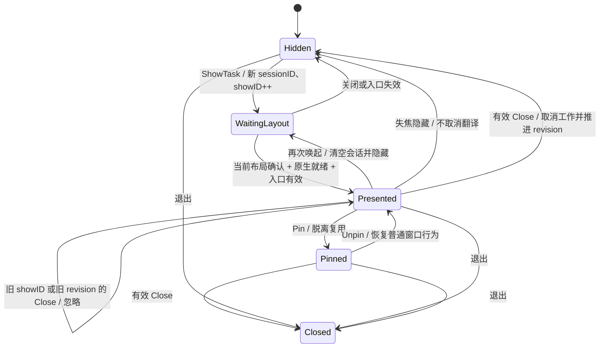
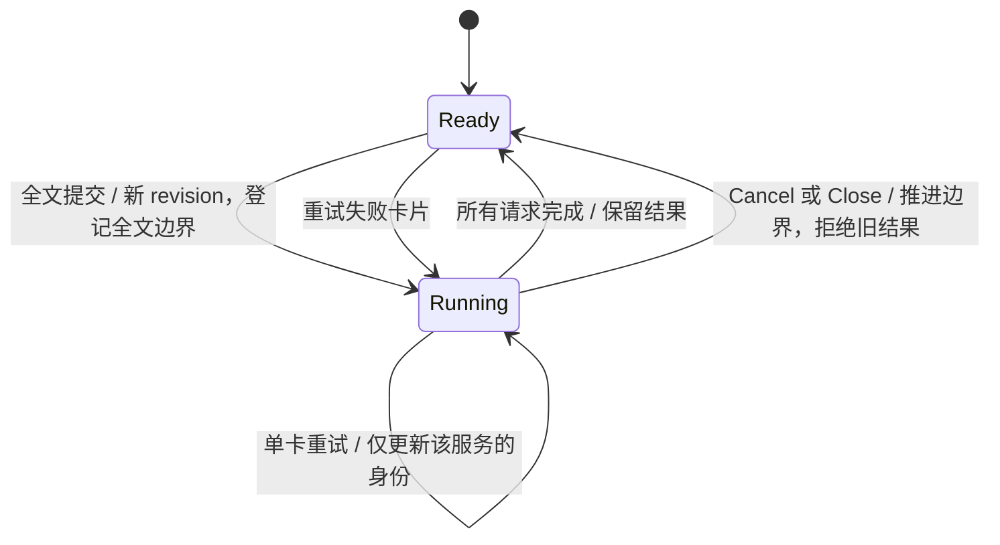

# 翻译窗口的状态与生命周期

本文记录当前实现的约束，用于后续拆分 translationSession / presentation 时保持行为。纯逻辑与 DOM 测试不代表 Win32 / WebView2 已实机验收；发布证据见 `e2e/translation-checklist.md`。

## 状态归属

| 范围 | 字段 | 含义与变化时机 |
|---|---|---|
| 全局入口 | `entryTask.id / ctx` | 新的输入、划词、OCR 入口使旧取词/识别任务失效；不直接取消独立窗口的翻译请求。 |
| 窗口对象 | `bubble.id`、`win` | 原生窗口身份，存活期间不变。输入和划词/OCR 各有一个可复用窗口；钉住后脱离复用。 |
| 内容会话 | `sessionID` | 一轮原文内容的会话身份。每次输入、划词或 OCR 入口都替换，重新唤起输入面板也清空旧会话。 |
| 快照顺序 | `generation` | 同一窗口内容会话的递增编号，用于前端拒绝旧 BubbleReset；同会话 OCR 阶段再以 layoutID 排序；新 sessionID 是不透明字符串，不能比较先后。 |
| 展示轮次 | `showID` | 每次明确唤起递增，即使 sessionID 和原文不变。防止上次展示的 Close 关闭重开的面板。 |
| 展示轮次 | `closeClaimed` | 同一 showID 的关闭至多接受一次；重新展示时复位。原生关闭也置位。 |
| 请求顺序 | `revision` | 后端已接受的最大请求/取消/关闭版本；前端发送新命令前递增。用于全文请求、取消、关闭排序及快照同步。 |
| 全文边界 | `fullRevision` | 最近一次全文请求或取消/关闭的边界。单卡重试必须比它新，但不必比另一服务的重试新。 |
| 当前请求 | `reqID` | 最大 revision 对应的请求，供页面总览和最新元信息使用；不能用于拒绝其他服务仍有效的结果。取消/关闭后清空。 |
| 全文请求 | `fullReqID` | 当前全文请求的身份。其元信息晚到时仍可登记未重试的服务，但不得覆盖已重试服务。 |
| 服务顺序 | `serviceRevisions[service]` | 每个服务已接受的最新重试版本；阻止同一卡片的旧重试倒序覆盖。全文请求时重置。 |
| 服务身份 | `serviceRequests[service]` | 该卡片当前接受哪个 reqID 的结果；在重试开始时原子登记，不等凭据读取完成。 |
| 正在运行 | `runCancels[reqID]` | 每个请求的取消函数。一个全文请求可能仍有其他服务未完成，单卡重试不取消它。完成时移除，全文替换/取消/关闭时统一取消。 |
| 识别阶段 | `cancelCapture`、`phase` | OCR 尚未变成翻译请求时的取消函数和展示阶段。识别结果只能写回原会话且 revision 仍为 -1 的窗口。 |
| 延迟显示 | `canShow`、`ready`、`awaitingLayout`、`layoutID`、`layoutSequence`、`presentationShown` | 原生页面就绪且当前布局确认后才显示；关闭或入口失效后不得迟到弹窗。 |

前端的 `cardRequests` 对应服务请求身份，`cards` 保存结果，`cardNodes` 保留未变化的 DOM 节点。普通失焦只隐藏；下次入口重新唤起时清空输入草稿、译文和请求身份。钉住的窗口保留独立会话。

## 展示与关闭

1. `ShowTask` 从工作 goroutine 进入，`showMu` 串行化展示准备；提交展示和 `Close` 的验证、原生操作在主线程执行。
2. Close 必须同时匹配窗口、sessionID、showID，且 revision 更新、closeClaimed 未置位。先验证，再取消和关闭；不能拆成另一个不受 showID 保护的 Cancel IPC。
3. `OnClose` 推进 revision、取消工作并发出带 showID 的 RunStopped。普通窗口阻止销毁并隐藏，钉住窗口允许销毁。
4. `OnBeforeQuit` 设置 quitting 后所有 OnClose 必须放行，避免中断应用退出序列。
5. `BubblePresented` 只同步展示身份、关闭后的版本和恢复状态，不重置草稿。迟到的旧 showID 事件不得作用于新展示。
6. `OnBlur` 延后到主线程下一次调度再判断；只有同一 showID、仍启用自动隐藏且当前确实失焦的可见窗口才隐藏。外部点击回调也校验 sessionID 和 showID，旧回调不能隐藏新展示。

`ShowTask` 返回的 `Shown` 表示接受了展示，不保证原生页面已可见。入口失效或应用 UI 循环已停止时，返回零值；需要启动后续工作者必须先检查 `Shown.Win != nil`。当前输入入口不读取返回值，划词和 OCR 调用者均检查窗口。正常取消不应当作需要弹窗的错误。

## 请求与取消

关键不变量：

- sessionID 不匹配的请求无效；跨会话不能比较 revision。
- 新选词接管同一未固定面板时，`replaceContent` 先取消全部旧请求（含重试），再替换会话与结果身份，然后才能启动新词请求。无需等旧译文；旧 HTTP 完成或元信息迟到都不能改写新词。取词阶段尚未成功时不替换面板内容，单纯隐藏也不取消请求。
- 全文请求必须比全局 revision 新。单卡重试只需同时越过 fullRevision 和本服务的重试版本。
- 不同服务的重试允许乱序到达；接收较早的独立重试不能降低全局 revision。
- 结果只按 `serviceRequests[service] == reqID` 接受，不能简单比较全局 reqID。
- 全文元信息不得重新取得已被重试替换的卡片；取消后不得再登记旧请求的元信息。
- OCR 完成不重新打开窗口，只更新仍属于该识别的会话。用户已经清空、编辑提交或取消时，旧 OCR 不能发布。

## 流式译文

- Bilibili、OpenAI（含兼容接口）、硅基流动和智谱请求 Chat Completions SSE；只读取首个 choice 的 `delta.content`，忽略角色、推理和 usage。兼容接口返回普通 JSON 时仍接受完整译文。
- SSE 不按整个传输体限制大小，重复元数据和被忽略的推理不会耗尽译文预算；单个事件（含多行 data）与累计译文分别限制为 1 MiB。超限时保留此前译文并返回明确错误。普通 JSON 响应仍限制为 1 MiB；连接与 TLS 握手各限 10 秒，响应头限 30 秒；首段 body 数据最多等待 60 秒，此后连续 30 秒无新字节才取消，推理与心跳也刷新空闲计时。持续输出没有总时长上限，超时保留部分译文并提示“生成超时，译文未完成”。
- `TranslationUpdateMsg.text` 始终是累计译文，`streaming=true` 表示仍在生成；最后一条更新为 `streaming=false`，失败时同时携带 `err` 和已经收到的文字。长文分段保留已完成段落与当前段落的部分输出。
- 首次非空文字立即发布，之后原生 IPC 更新最多每秒 25 次，完成或失败必发终态。每个服务在 Ready 快照中只保留最新累计结果，取消时把进行中的快照结算为错误，避免重挂载后继续显示“生成中”。
- 骨架屏只持续到首段文字；生成中显示“生成中”，复制、朗读和命名格式仅在成功完成后启用。断流、截断和取消保留译文，标注未完成并提供重试。增量更新沿用同一卡片和正文节点，保持阅读位置与键盘焦点。
- 设置页连接测试使用 `stream=false` 的普通翻译请求，保留独立 12 秒截止时间，成功时显示“连接成功”。正式翻译使用 `stream=true`，不因首包较慢而自动重发，不把缺失完成标记的 EOF 当成成功。
- 共用 Chat 请求优先按服务商业务码区分模型、余额、额度、权限和输入长度错误，再按 HTTP 状态兜底。HTTP 失败响应最多读取 16 KiB，不直接展示响应正文；JSON 和 SSE 错误复用同一解析，流式失败保留已有译文。
- 所有增量和终态仍经过原有 `serviceRequests` / `cardRequests` 过滤，重试、全文替换与取消后的旧流不能重新取得卡片。

## 服务配置

- OpenAI、硅基流动和智谱独立保存模型配置，留空恢复默认；凭据仍保存在系统密钥环。
- 三家共用模型草稿逻辑，设置同步保留未提交的输入；修改模型后清除旧测试结果，测试期间锁定模型与 OpenAI 地址。
- 连接测试等待设置保存；保存失败时中止测试。回滚成功时设置仍与后端一致，可直接重试；回滚失败需在后续保存成功后重试。保存队列不因失败中断。

## 锁与前端卸载

`m.mu` 保护窗口状态，持有时不得调用可能等待主线程的原生窗口方法。主线程不得直接进入 ShowTask：另一工作线程可能持有 showMu 正等待主线程提交展示。主线程回调只派发 ShowTask 工作。

页面卸载只清理 DOM 监听、事件订阅及本次挂载的 UI 状态，不发送业务取消命令。失焦隐藏不会触发 route 卸载。重新挂载或切换路由会中止旧 AbortController；旧 Ready 的成功/失败回调都必须检查是否已卸载。异步格式结果通过 CardState 对象身份拒绝旧卡片更新。

## 剪贴板恢复边界

恢复失败只保留一个内存快照，后续模拟复制取词暂停，避免覆盖唯一的恢复内容。UIA 成功路径、直接输入和 OCR 仍可用。用户可主动重试恢复或放弃；退出进程后快照不保留。

恢复前分配全部格式，写回时使用有效 HWND。只重试失败格式，排除标记失败不写正文；手动恢复仍要比较剪贴板序列号，新的用户复制优先。32 MiB 是快照总数据限制，不是进程内存增量上限：Go 快照与预分配的原生内存会同时存在。性能优化应先测量，不删除格式以换取速度。

模拟复制期间临时安装键盘和鼠标低级钩子。每次复制的 SendInput 带独立 ExtraInfo 标记，键盘钩子忽略带有本次标记的注入事件。复制前确认鼠标按键已经松开，复制期间单纯移动指针不会取消取词。其他键盘事件、鼠标按键或滚轮事件会取消本次复制事务，日志只记录首个取消原因的类别。结束后卸载钩子，安装失败则拒绝模拟复制。不能再用 GetLastInputInfo 的变化区分用户操作与本次模拟按键。

## 已有验证与待补证据

- `session_test.go`：请求排序、服务隔离、过期关闭拒绝；没有驱动真实主线程队列和原生窗口。
- `tests/bubble.test.ts`：监听回收、旧挂载结果隔离、卡片身份/焦点、前端请求过滤；没有验证 WebView2 中文输入法。
- `internal/selection/clipboard_restore_test.go`：清空/格式写入故障注入及保护策略；没有调用 Windows 原生剪贴板。
- Windows 的 A08、C02、B05、D06/D07 证据仍待补齐。未测不记为通过，也不因交叉编译成功而关闭发布门禁。

## 新会话与内容尺寸更新

- `ShowTask` 对所有入口执行 `replaceContent`，取消被替换会话的工作，递增 `layoutID`，置 `awaitingLayout`，先隐藏复用窗口，再发送新状态。
- 前端 `apply` 在 `tick` 后调整 textarea 并同步测量气泡根节点。`ResizeObserver` 持续观察该节点，覆盖译文流式增长、卡片折叠、输入框变化和缩放；窗口 resize 时也测量。每次读取当前 DOM，不使用可能过期的 observer entry；相同身份和宽高去重，卸载后断开 observer 和窗口监听。
- 每条 `BubbleSvc.Rendered` 测量携带 sessionID / showID / layoutID、CSS 高度及页面单调递增的 sequence（组件重新挂载不重置；Ready 快照提供后端已接受序号的下界，页面重新加载后继续递增）。后端在 UI 线程核对调用窗口、全部身份和 sequence，只接受更新的测量；较高译文先到、较早短布局后到时，后者不能覆盖尺寸。导航取消的旧页面 IPC 在 UI 线程执行前再次校验 context，不能写回新页面。后续有效测量也可以让窗口正常缩短。
- **尺寸只有一条写入通路**：气泡禁用 mygo FitContent，由 Rendered 将 CSS 高度按 Page.ZoomFactor 转为 DIP，通过 SetContentSize 更新内容区尺寸，并按工作区和锚点重新定位。固定宽度仍由窗口约束控制。避免应用 SetSize 与 FitContent 的缓存及去重逻辑竞争。
- 只有布局确认、原生 OnReadyToShow 和入口有效性同时满足才首次显示；`claimShow` 在锁内只允许每个展示轮次显示一次。后续测量仍调整尺寸，但不会重新显示失焦隐藏的窗口。钉住窗口的后续尺寸更新不受新入口使旧 canShow 失效的影响。
- OCR 完成更新文字时递增 layoutID，防止迟到的“正在识别”布局释放新内容的首次显示；即使旧布局已确认但原生页面尚未就绪，也必须等待文字布局。`presentationShown` 区分已确认和已显示。
- 本地依据：mygo v0.8.3 `bridge.go` 中绑定调用由 goroutine 执行，content-size 在主线程同步处理；`window.go` 的 SetSize 不同步 FitContent 缓存，`fit_content.go` 与前端 sizeReporter 会对相同尺寸去重。因此不能混用两条内容尺寸写入通路。SetContentSize 的 DIP 语义及 Page.ZoomFactor 以本地源码为准。
