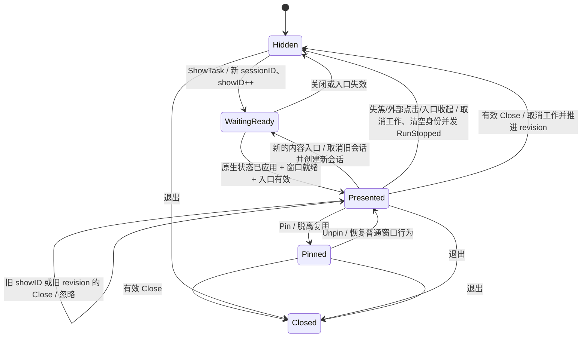
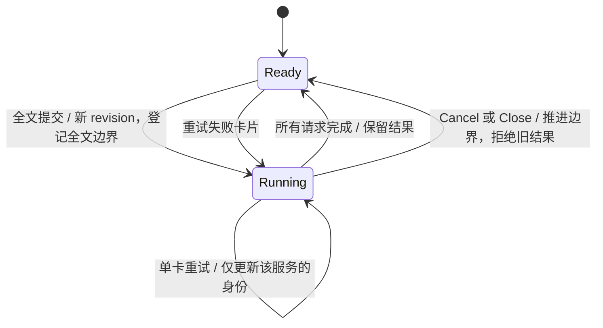

# 翻译窗口的状态与生命周期

本文记录当前实现的约束，用于后续拆分 translationSession / presentation 时保持行为。纯逻辑与原生 `ui.NewTester` 测试不代表桌面已实机验收；Windows 的运行方式和待验收项见 `e2e/README.md`。

## 状态归属

| 范围 | 字段 | 含义与变化时机 |
|---|---|---|
| 全局入口 | `entryTask.id / ctx` | 新的输入、划词、OCR 入口使旧取词/识别任务失效；入口切换同时收起并取消未钉住气泡的工作。 |
| 窗口对象 | `bubble.id`、`win` | 原生窗口身份，存活期间不变。输入、划词和 OCR 共用一个可复用窗口；钉住后脱离复用。 |
| 内容会话 | `sessionID` | 一轮原文内容的会话身份。新的输入、划词或 OCR 入口替换会话；当前输入入口仍有效且未钉住面板已可见时，重复打开只聚焦，保留会话。 |
| 快照顺序 | `generation` | 同一窗口内容会话的递增编号，用于原生视图拒绝旧会话快照；新 sessionID 是不透明字符串，不能比较先后。 |
| 展示轮次 | `showID` | 每次明确唤起递增，即使 sessionID 和原文不变。防止上次展示的 Close 关闭重开的面板。 |
| 展示轮次 | `closeClaimed` | 同一 showID 的关闭至多接受一次；重新展示时复位。原生关闭也置位。 |
| 请求顺序 | `revision` | 后端已接受的最大请求/取消/关闭版本；原生视图发送新命令前递增。用于全文请求、取消、关闭排序及快照同步。 |
| 全文边界 | `fullRevision` | 最近一次全文请求或取消/关闭的边界。单卡重试必须比它新，但不必比另一服务的重试新。 |
| 当前请求 | `reqID` | 最大 revision 对应的请求，供视图总览和最新元信息使用；不能用于拒绝其他服务仍有效的结果。取消/关闭后清空。 |
| 全文请求 | `fullReqID` | 当前全文请求的身份。其元信息晚到时仍可登记未重试的服务，但不得覆盖已重试服务。 |
| 服务顺序 | `serviceRevisions[service]` | 每个服务已接受的最新重试版本；阻止同一卡片的旧重试倒序覆盖。全文请求时重置。 |
| 服务身份 | `serviceRequests[service]` | 该卡片当前接受哪个 reqID 的结果；在重试开始时原子登记，不等凭据读取完成。 |
| 正在运行 | `runCancels[reqID]` | 每个请求的取消函数。一个全文请求可能仍有其他服务未完成，单卡重试不取消它。完成时移除，全文替换/取消/关闭时统一取消。 |
| 识别阶段 | `cancelCapture`、`phase` | OCR 尚未变成翻译请求时的取消函数和展示阶段。识别结果只能写回原会话且 revision 仍为 -1 的窗口。 |
| 延迟显示 | `canShow`、`ready`、`presentationShown` | 原生视图应用当前状态、窗口就绪且入口仍有效时首次显示；关闭或入口失效后不得迟到弹窗。 |

原生 `bubbleView.serviceReqIDs` 对应服务请求身份，`cards` 保存结果，控件通过稳定身份保持编辑、选择和焦点状态。用户失焦、外部点击或新的入口收起未钉住气泡时，都会结束当前展示会话：取消全文、单卡重试和 OCR，清空结果身份，置 `closeClaimed` 并发出 `RunStopped`。隐藏后重新唤起时开启新会话并清空输入草稿、译文和请求身份。当前输入入口仍有效且未钉住面板已可见时，重复打开只聚焦，不撤销入口、不重置内容，也不停止在途翻译；仅递增 showID，使迟到的旧关闭、失焦和外部点击回调失效。钉住的窗口保留独立会话。

## 展示与关闭

### 各窗口入口与退出

| 窗口 | 打开与复用 | 隐藏、关闭与退出 |
|---|---|---|
| 输入面板 | 当前入口有效、未钉住且已可见时重复打开只聚焦并推进 showID，保留草稿、语言和工作；其余输入入口隐藏截图遮罩、结束旧展示，再在共用窗口开启空白会话 | 自动隐藏启用时，失焦或外部点击结束当前展示会话：取消工作、清空请求身份并发出 `RunStopped`，然后隐藏；Esc/关闭按钮同样取消工作后隐藏；隐藏后重开替换会话 |
| 划词/OCR 气泡 | 使用与输入面板相同的窗口，每次新入口替换会话；划词采集完成并仍有效时才接管窗口；OCR 先展示识别状态，再由同会话更新识别结果 | 自动隐藏启用时失焦或外部点击，以及入口切换或关闭，都会结束当前展示会话：取消采集/翻译、清空请求身份并发出 `RunStopped`；后续结果不能更新或重新显示已隐藏窗口 |
| 截图遮罩 | OCR 入口先隐藏临时气泡，按当前显示器打开原生遮罩；输入或划词入口撤销旧采集并隐藏遮罩 | Esc、右键、失焦或原生关闭取消当前轮次；普通隐藏保留可复用窗口，发生过拖拽或仍被抓屏使用的窗口按现有租约规则更换/延后销毁 |
| 钉住气泡 | 脱离共用复用槽，后续入口按需创建窗口；取消钉住后回到共用槽，取消并销毁被替换的临时窗口，即使它已经隐藏 | 不自动失焦隐藏；关闭真正销毁并停止工作 |
| 设置窗口 | 独立单实例，重复打开 Show/Focus，不获取翻译入口所有权 | 关闭销毁原生窗口；应用继续持有设置控制器和同一任务队列，重开继承待保存状态；打开设置可能因气泡失焦触发自动隐藏 |
| 应用退出 | OnBeforeQuit 标记 quitting 并撤销入口，新入口不再派发 | 所有窗口 OnClose 放行，保留托盘常驻与真正退出两条不同路径 |

1. `ShowTask` 从工作 goroutine 进入；选择或创建共用窗口、提交展示，以及 `SetPinned` 和 `Close` 的验证和原生操作在主线程执行。
2. Close 必须同时匹配窗口、sessionID、showID，且 revision 更新、closeClaimed 未置位。原生视图调用前预留递增 revision，但不提前清除活动请求和卡片；拒绝或失败也不回退已消耗序号。后端先验证，再取消和关闭；不能拆成另一个不受 showID 保护的 取消调用。
3. `OnClose` 推进 revision、取消工作并发出带 showID 的 RunStopped。已经接受的 Close 终止当前展示，关闭等待期间发出的下一条同展示命令可能被这个边界拒绝，视图按匹配的 RunStopped 结算。若重复打开先在 UI 线程推进 showID，旧 Close 则被拒绝，旧 RunStopped 也不得影响新展示。普通窗口阻止销毁并隐藏，钉住窗口允许销毁。失焦、外部点击和新的入口收起通过同一语义结束未钉住展示，立即取消工作、清空请求身份并发出 RunStopped。
4. `OnBeforeQuit` 设置 quitting 后所有 OnClose 必须放行，避免中断应用退出序列。
5. `BubblePresented` 只同步展示身份、关闭后的版本和恢复状态，不重置草稿。迟到的旧 showID 事件不得作用于新展示。
6. `OnBlur` 延后到主线程下一次调度再判断；只有同一 showID、仍启用自动隐藏且当前确实失焦的可见窗口才隐藏。外部点击回调也校验 sessionID 和 showID，旧回调不能隐藏新展示。
7. `SetPinned` 校验调用窗口、sessionID 和 showID，拒绝已经关闭或尚未展示的轮次。视图收到接受结果后才更新当前会话的钉住状态。

`ShowTask` 返回的 `Shown` 表示接受了展示，不保证原生窗口已可见。入口失效或应用 UI 循环已停止时，返回零值；需要启动后续工作者必须先检查 `Shown.Win != nil`。当前输入入口不读取返回值，划词和 OCR 调用者均检查窗口。正常取消不应当作需要弹窗的错误。

## 请求与取消

关键不变量：

- sessionID 不匹配的请求无效；跨会话不能比较 revision。
- 已收起或关闭的未钉住展示拒绝新的全文、单卡重试、OCR 完成和迟到首显；新的 `replaceContent` 会复位该边界并允许新任务。
- 新的输入、划词和 OCR 入口在开始展示/采集前立即 `HideTransient`，结束旧未钉住气泡的会话，不等待新内容返回；划词先 `selection.Prepare()` 保存来源，再收起旧气泡。`replaceContent` 再次确保取消全部旧请求（含重试），替换会话与结果身份后才能启动新请求。取词失败也不恢复旧会话；旧 HTTP 完成或元信息迟到不能改写新词。
- `closeClaimed` 封死已收起会话的后续全文请求、单卡重试、OCR 写回和迟到首显，即使迟到命令带更高 revision 也无效。只有开启新会话才复位；钉住窗口不受临时气泡收起影响。
- 全文请求必须比全局 revision 新。单卡重试只需同时越过 fullRevision 和本服务的重试版本。
- 不同服务的重试允许乱序到达；接收较早的独立重试不能降低全局 revision。
- 结果只按 `serviceRequests[service] == reqID` 接受，不能简单比较全局 reqID。
- 全文元信息不得重新取得已被重试替换的卡片；取消后不得再登记旧请求的元信息。
- OCR 完成不重新打开窗口，只更新仍属于该识别的会话。用户已经清空、编辑提交或取消时，旧 OCR 不能发布。

## 流式译文

- Bilibili、OpenAI（含兼容接口）、硅基流动和智谱请求 Chat Completions SSE；只读取首个 choice 的 `delta.content`，忽略角色、推理和 usage。兼容接口返回普通 JSON 时仍接受完整译文。
- SSE 不按整个传输体限制大小，重复元数据和被忽略的推理不会耗尽译文预算；单个事件（含多行 data）与累计译文分别限制为 1 MiB。超限时保留此前译文并返回明确错误。普通 JSON 响应仍限制为 1 MiB；连接与 TLS 握手各限 10 秒，响应头限 30 秒；首段 body 数据最多等待 60 秒，此后连续 30 秒无新字节才取消，推理与心跳也刷新空闲计时。持续输出没有总时长上限，超时保留部分译文并提示“生成超时，译文未完成”。
- `TranslationUpdateMsg.text` 始终是累计译文，`streaming=true` 表示仍在生成；最后一条更新为 `streaming=false`，失败时同时携带 `err` 和已经收到的文字。长文分段保留已完成段落与当前段落的部分输出。
- 首次非空文字立即发布，之后原生视图更新最多每秒 25 次，完成或失败必发终态。每个服务在状态快照中只保留最新累计结果，取消时把进行中的快照结算为错误，避免重新应用状态后继续显示“生成中”。
- 骨架屏只持续到首段文字；生成中显示“生成中”，复制、朗读和命名格式仅在成功完成后启用。断流、截断和取消保留译文，标注未完成并提供重试。增量更新沿用同一卡片状态和控件身份，保持阅读位置与键盘焦点。
- 设置页连接测试使用 `stream=false` 的普通翻译请求，保留独立 12 秒截止时间，成功时显示“连接成功”。正式翻译使用 `stream=true`，不因首包较慢而自动重发，不把缺失完成标记的 EOF 当成成功。
- 共用 Chat 请求优先按服务商业务码区分模型、余额、额度、权限和输入长度错误，再按 HTTP 状态兜底。HTTP 失败响应最多读取 16 KiB，不直接展示响应正文；JSON 和 SSE 错误复用同一解析，流式失败保留已有译文。
- 所有增量和终态仍经过原有 `serviceRequests` / `serviceReqIDs` 过滤，重试、全文替换与取消后的旧流不能重新取得卡片。

## 服务配置

- OpenAI、硅基流动和智谱独立保存模型配置，留空恢复默认；凭据仍保存在系统密钥环。
- 三家共用模型草稿逻辑，设置同步保留未提交的输入；修改模型后清除旧测试结果，测试期间锁定模型与 OpenAI 地址。
- 连接测试在队列中的前置设置任务完成后启动；最后一次保存失败时中止测试，后续成功保存后可重试。保存失败时显示错误并在队列清空后从后端回读。保存队列不因失败中断，关闭设置窗口仍排空已提交快照并保存模型/地址草稿。

## 锁与原生视图关闭

`m.mu` 保护窗口状态，持有时不得调用可能等待主线程的原生窗口方法。主线程回调派发入口工作；窗口复用、创建和销毁由主线程串行提交。

气泡视图状态归 UI 线程，后台结果通过 `Window.Update` 发布，应用前校验会话和请求身份。关闭或隐藏未钉住气泡按展示生命周期取消工作；钉住窗口独立。设置控制器由应用持有，通过互斥锁保护状态；设置保存、凭据写入和状态刷新共享串行任务队列。关闭窗口刷新模型/地址草稿并清理临时 UI 状态，重开复用乐观设置；连接测试取消，额度结果按请求代次丢弃。`Dispose` 仅用于最终退出或测试清理，停止接收任务并排空已入队工作。退出监听在任务未排空时暂缓退出，后台等待 `taskDone` 后再次发起 Quit；UI 线程继续处理任务的原生调用，禁止同步等待队列。

## 剪贴板恢复边界

恢复失败只保留一个内存快照，后续模拟复制取词暂停，避免覆盖唯一的恢复内容。UIA/AX 成功路径、直接输入和 OCR 仍可用。用户可主动重试恢复或放弃；退出进程后快照不保留。

Windows 恢复前分配全部格式，写回时使用有效 HWND。只重试失败格式，排除标记失败不写正文；手动恢复仍要比较剪贴板序列号，新的用户复制优先。

macOS 按 item 保留所有可读取表示，先准备全部原生替换对象再清空。失败后只保留调用前已验证的版本或本次 `clearContents` 返回的版本，不重新读取并认领当前 `changeCount`；下一次恢复仍要重新比对版本。检测到外部写入、入口变化或所有权不明时保留备份并拒绝覆盖。macOS 没有剪贴板锁或 CAS，版本检查不能使检查与写入成为原子操作。

快照保留 DIB、DIBV5 和其他可读取格式；只有实际备份至少一个 DIB/DIBV5 后，才省略可由 Windows 合成的 CF_BITMAP。两种 DIB 表示均保留，不假设透明度/颜色元数据相同。CF_PALETTE 用 GetObjectW / GetPaletteEntries 保存 LOGPALETTE，再用 CreatePalette 创建恢复句柄；未转移的调色板句柄用 DeleteObject 释放。其他未支持的 GDI/owner/display 格式以及任何未知格式读取失败仍阻断模拟复制，枚举失败也不能视为空剪贴板。[格式转换规则](https://learn.microsoft.com/en-us/windows/win32/dataxchg/clipboard-formats)

DIB/DIBV5 可以使用 128 MiB 快照总预算，其他格式合计仍限 32 MiB，小图片不会放宽私有格式限制；每次读数据前先检查剩余预算。该预算不是进程内存增量上限：Go 快照与预分配的原生内存会同时存在，最多约 256 MiB 备份载荷，另有原剪贴板、Go GC 和其他运行时开销。超限保守拒绝，不裁剪原始图片或丢弃未知格式。

诊断日志区分 UIA 的 selected、empty、miss、timeout、slot_busy、breaker_open、error 与 canceled，另记录 worker 返回耗时，以识别请求超时后仍在运行的 COM 调用。UIA 800ms 请求超时、150ms 排队和原有熔断规则不变，槽位仍由实际 COM worker 归还。剪贴板日志记录枚举格式 ID/名称、读取字节数/耗时，以及 snapshot、prepare_restore、watch_input、restore 等失败阶段；不记录剪贴板或选区正文。既有 `--grab` 命令的 stdout JSON 仍按设计包含取词文本。

Windows 模拟复制期间临时安装键盘和鼠标低级钩子。每次复制的 SendInput 带独立 ExtraInfo 标记，键盘钩子忽略带有本次标记的注入事件。复制前确认鼠标按键已经松开，复制期间单纯移动指针不会取消取词。其他键盘事件、鼠标按键或滚轮事件会取消本次复制事务，日志只记录首个取消原因的类别。结束后卸载钩子，安装失败则拒绝模拟复制。不能再用 GetLastInputInfo 的变化区分用户操作与本次模拟按键。

## 已有验证与待补证据

- `app_test.go`：入口任务所有权和目标语言解析；`app_darwin_test.go` 补充 workspace 代次与旧入口取消。
- `internal/ui/bubble/session_test.go`：请求排序、服务隔离、过期关闭拒绝；没有驱动真实主线程队列和原生窗口。
- `internal/ui/bubble/ui_test.go`、`internal/ui/bubble/controls_test.go`、`internal/ui/bubble/regression_test.go`：输入、菜单、流式卡片、复制/重试、控件焦点、会话隔离与尺寸；`internal/ui/bubble/scroll_test.go` 覆盖原生滚动。Tester 不能替代 Windows 中文输入法与真实窗口验收。
- `internal/ui/settings/view_test.go`：模型与凭证、保存回滚与 FIFO 排空、窗口重开与凭据顺序、分组焦点及过期结果隔离；覆盖详情以实际用例断言为准，系统凭据持久化仍需 Windows 验收。
- `internal/ui/settings/hotkeys_test.go`、`internal/ui/settings/platform_test.go`：按键事件在下一帧前提交、录制控件焦点、空格组合键与 macOS 物理键位，以及 Command+Option+A/S/D 的保存和显示、完整 Control+Option+A/S/D 的逐项保存及重新加载；不等于真实全局热键触发验收。
- `internal/ui/snip/capture_test.go`：取消或入口失效时释放截图租约，使用注入的释放回调，不执行真实截屏。
- `internal/selection/clipboard_restore_test.go`：清空/格式写入故障注入及保护策略；没有调用 Windows 原生剪贴板。
- `internal/selection/pasteboard_test.go`：macOS item 快照，以及准备/写入失败、外部复制、取消和安全重试的版本保护；使用注入操作，不修改系统剪贴板。
- `internal/selection/clipboard_snapshot_test.go`：位图必须有已保存 DIB、保留两种 DIB/其他格式、枚举与私有格式失败、4K 图片和预算边界；使用注入读取，不调用 Windows 剪贴板。
- `internal/selection/clipboard_snapshot_windows_test.go`：独立 GDI 调色板句柄往返和预算/无效载荷检查；不改动系统剪贴板，需在 Windows 执行，交叉编译不代表已运行。
- `e2e/README.md` 中的 Windows 桌面手工验收仍待执行；未测不记为通过，交叉编译成功不能替代实机证据。

## 新会话与内容尺寸更新

- 输入入口在 `entry.begin()` 前检查当前可见输入是否仍持有入口：命中时保持已展示状态，递增 showID 并通过原生视图的 `onPresented` 聚焦，保留草稿和在途工作。`Close` 只接受当前 sessionID、showID 和更新的 revision，旧关闭不能清空活动请求。其余入口由 `ShowTask` 执行 `replaceContent`，取消旧会话工作、递增 generation 并生成新 sessionID；先隐藏复用窗口、重置尺寸和位置，再向原生视图应用新状态。
- 气泡使用 `ui.View`，内容高度由原生视图在 UI 线程测量，经 `onHeightMeasured` 传给窗口。高度和工作区上限均使用原生逻辑单位，`bubbleLayoutHeight(height, limit)` 负责夹取和小数舍入；直接使用原生测量与窗口尺寸 API。
- 后续内容尺寸由 `SetContentSize` 更新，保持固定宽度，并按工作区与锚点重新定位。相同高度不重复写入；已关闭展示拒绝测量，测量本身不会调用首次显示。钉住窗口的后续尺寸更新不受新入口使旧 canShow 失效的影响。
- `ShowTask` 在原生视图应用当前快照后尝试显示；若窗口尚未就绪，则由 `OnReadyToShow` 再次尝试，并重新检查入口有效性。`claimShow` 在锁内只允许每个有效且未关闭的展示轮次显示一次，复用窗口保留原生 ready 状态。
- OCR 完成只更新仍属于该 sessionID、未关闭且 revision 仍为 -1 的展示；不替换 generation 或 showID，也不重新打开窗口。异步快照经 `Window.Update` 回到 UI 线程，由视图的会话和请求身份检查拒绝过期工作。
- 剪贴板恢复和放弃恢复在工作 goroutine 执行，完成回调通过 `Window.Update` 回到 UI 线程；视图负责 busy 状态、过期回调和提示的检查。
- 本地依据：mygo v0.8.3 `ui/doc.go` 规定视图构建在主线程执行，异步状态通过 `Window.Update` 发布；窗口尺寸由 `window.go` 的 `SetContentSize` 使用原生逻辑单位更新。
